 

## ✦ About

Web Developer based in Mumbai, India, with 4 years of professional experience building dynamic, responsive, database-driven websites and web applications. I work mainly with **Core PHP, Laravel and CodeIgniter** on the backend and **JavaScript, jQuery, Bootstrap** on the frontend, with **MySQL** underneath.

My work covers custom CMS and admin panels, REST APIs, payment gateway integrations (Razorpay, Easebuzz), donation management and email notification workflows, plus deployment, debugging and performance tuning. I like learning new technologies and turning requirements into efficient, maintainable web solutions.

**Currently:** freelance web development (PHP and Laravel) since 2026, after working as a Web Developer in the Digital Department at Kokan Kala Va Shikshan Vikas Sanstha (Aug 2022 – Aug 2026).

## ✦ Achievements & Certifications

| Recognition | Year |
|---|---|
| 🏆 Beyond Duties Award | 2023 |
| 🏆 Best Employee Award | 2024 |
| 🏆 Best Team Award | 2025 |
| 🏆 Punctual Employee Recognition | 2026 |
| 📜 PHP & Laravel Certification | 2024 |
| 📜 Tally Certification | 2018 |
| 📜 MS-CIT Certification | 2015 |

**Education:** Bachelor of Computer Applications (BCA)

## ✦ Selected Work

| Project | What I worked on |
|---|---|
| **[NGO Website & CMS](https://kokanngo.org/)** | NGO websites in PHP, CodeIgniter and Laravel, with dynamic content management, an admin dashboard, and donation, career and emergency assistance modules. |
| **[Donation Management System](https://cdf.world/)** | Laravel-based donation functionality with Razorpay and Easebuzz integration, donation tracking, email notifications and payment workflows. |
| **[Portfolio](https://komal1526.github.io/komalkamble.github.io)** | Personal portfolio with more work samples. |
| **Dynamic Website Development** | Multiple responsive, database-driven sites in PHP, HTML, CSS, JavaScript and Bootstrap, with admin panels, SEO and performance work. |

> Live sites are linked above as samples of the organisation's work I contributed to.

## ✦ Skills

| | |
|---|---|
| **Backend** | `Core PHP` · `Laravel` · `CodeIgniter` · `REST APIs` · `PHP OOP` |
| **Frontend** | `HTML5` · `CSS3` · `JavaScript` · `jQuery` · `Bootstrap` · `AJAX` · `Responsive Design` |
| **Database** | `MySQL` · `phpMyAdmin` · `Database Design` · `SQL` |
| **Tools** | `Git` · `GitHub` · `VS Code` · `XAMPP` · `cPanel` · `Postman` · `AWS (server knowledge)` |
| **CMS & Integrations** | `WordPress` · `Razorpay` · `Easebuzz` · `Email Integration` · `Third-party APIs` |
| **Strengths** | Problem-solving · Debugging · Analytical thinking · Team collaboration · Time management · Communication |

## ✦ GitHub Activity

Live contribution data via <a href="https://ghchart.rshah.org">ghchart.rshah.org</a>, generated from my public GitHub activity.

<!--
OPTIONAL stats card (uncomment only if you want it; the public Vercel instance of
github-readme-stats is often rate-limited, which can leave a broken image):

-->

## ✦ Connect

- 🌐 **Portfolio:** [komal1526.github.io/komalkamble.github.io](https://komal1526.github.io/komalkamble.github.io)
- 💼 **LinkedIn:** [linkedin.com/in/komal-kamble](https://linkedin.com/in/komal-kamble/)
- 🏢 **Organisation site:** [kokanngo.org](https://kokanngo.org/)
- 🧩 **Project samples:** [cdf.world](https://cdf.world/)

 

